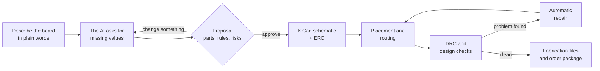
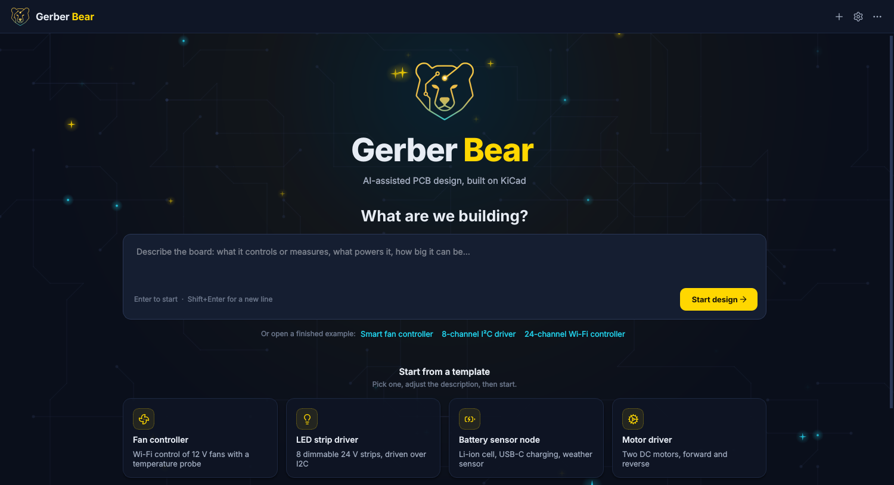
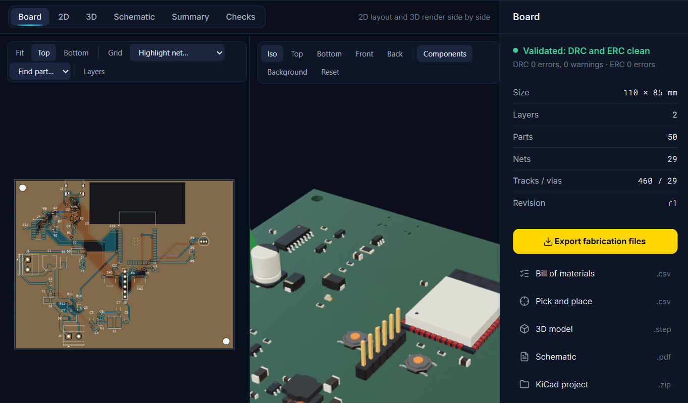

 

 

**Gerber Bear** is a free Windows desktop app that turns a conversation into a printed circuit board. You say what the board should do. An AI engineer asks for anything that is missing, proposes an architecture you approve, and the app builds the design with [KiCad](https://www.kicad.org): schematic, placed and routed PCB, rule checks, 3D model and the files to order it.

## How a board is made

The AI only gathers requirements and explains. The engineering is done by deterministic code and by KiCad itself, and every result is reported as KiCad reports it: if a check fails, the app says so and does not call the board ready.

## What you get

| Output | Details |
|---|---|
| Schematic | Hierarchical KiCad schematic, checked against KiCad's own netlist and **ERC** |
| PCB | Placed and **routed** 2- or 4-layer board, checked with KiCad **DRC**, with automatic repairs |
| Design checks | What KiCad does not check: datasheet supply ranges, voltage ratings, LED currents, resistor power, rails without a source, I2C address clashes, ESP32 boot pins, trace widths against current |
| Views | Live 2D layout, lit 3D model, schematic, summary and a checks report inside the app |
| Fabrication | Gerbers, drill, pick-and-place, BOM, STEP and GLB 3D models, PDF schematic, the native KiCad project |
| Order package | Gerber zip, assembly BOM and placement files for JLCPCB or PCBWay, LCSC part numbers confirmed in the catalogue, and the exact order-form values |

## What it can design

ESP32 Wi-Fi controllers, or boards driven over I2C by a Raspberry Pi or Arduino, built from tested circuit blocks:

| Area | Supported |
|---|---|
| Power | 5 to 24 V screw terminal or barrel jack with protection, USB-C 5 V, one Li-ion cell with USB-C charging |
| Outputs | Up to 32 MOSFET outputs, 1 A each: fans, LED strips, valves, heaters, lamps |
| Motors and relays | Up to 4 brushed DC motors (forward and reverse, 2 A), up to 8 relays (up to 30 V) |
| Sensors | DS18B20, SHT31, BME280, ADS1115 four-channel 16-bit ADC |
| Interfaces | USB-C programming, RS-485 (Modbus), CAN, I2C OLED connector |
| Board | 2 or 4 layers, automatic or fixed size, 0, 2 or 4 mounting holes |

Mains-voltage and high-speed designs are declined on purpose. Full list: [WHAT_IT_CAN_DESIGN.md](WHAT_IT_CAN_DESIGN.md).

> **Beta.** No circuit simulation is performed. Review every design (it opens directly in KiCad) before you order boards.

## Screenshots

<table>
  <tr>
    <td width="50%"> Start screen: describe a board or start from a template</td>
    <td width="50%"> A generated board in 2D and 3D, validated with DRC and ERC</td>
  </tr>
</table>

## Install

| Step | How |
|---|---|
| 1. Install KiCad | Download **KiCad 8, 9 or 10** from <https://www.kicad.org/download/windows/> and install it with the default options |
| 2. Install Gerber Bear | Download **[GerberBear-Setup.exe](https://github.com/Ahmed-ssam/GerberBear/releases/latest/download/GerberBear-Setup.exe)** and run it. Leave "Create a desktop shortcut" ticked to get a desktop icon |
| 3. Add an AI key | Start Gerber Bear. The welcome screen checks KiCad and asks for an AI key: a free Google Gemini key from <https://aistudio.google.com/apikey> works, and OpenAI or a local OpenAI-compatible server also work |

Windows may show "Windows protected your PC" because the installer is not code-signed: click **More info**, then **Run anyway**. Python, Java and the Freerouting autorouter are included in the installer. The AI key is stored only in Windows Credential Manager.

## Use

Describe the board, answer the questions, approve the proposal, wait a few minutes, review the **Checks** view, then **Export fabrication files**. The [user guide](docs/USER_GUIDE.md) covers every screen.

## Problems and ideas

Use [GitHub Issues](../../issues). In the app, **⋯ → Save diagnostic report** creates a zip (logs, system details and the run record, never your API key) to attach to the issue.

## Privacy

Your conversation goes to the AI provider you chose, with your key. Part values go to a public JLCPCB parts index when the order package is built. Nothing else leaves your PC. Details: [PRIVACY.md](PRIVACY.md).

## Build from source

See [CONTRIBUTING.md](CONTRIBUTING.md).

## Licence

Gerber Bear is free software under the GNU General Public License v3.0 or later ([LICENSE](LICENSE)). It uses KiCad (GPL-3.0) as an external program and bundles Freerouting (GPL-3.0), Eclipse Temurin, Python, Qt/PySide6 (LGPL-3.0) and others under their own licences: [installer/THIRD_PARTY_NOTICES.txt](installer/THIRD_PARTY_NOTICES.txt). Boards you design with Gerber Bear are yours, under any terms you choose.

The README artwork uses the Inter and Roboto Mono typefaces (SIL Open Font License) converted to outlines, and Lucide icons (ISC).
